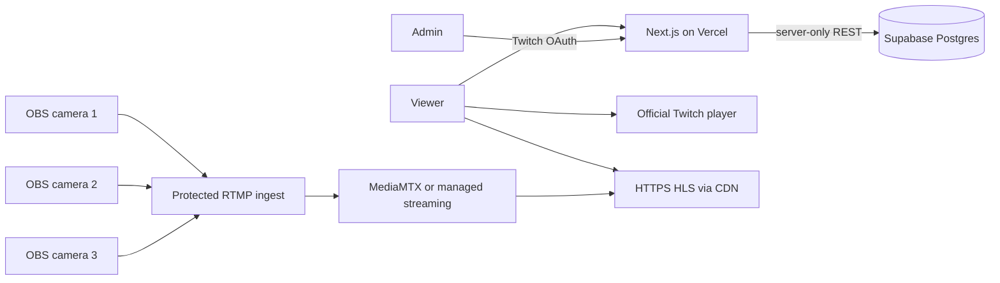

# TiiA Live architecture

## Application architecture

The website remains the control and presentation plane. The Twitch broadcast is the main player; each MediaMTX/HLS camera is an independent secondary feed. The frontend starts at most one secondary HLS player at a time. No production media host, CDN, or camera playback endpoint is supplied by this repository.

## Persistent application state

`supabase/migrations/202610160001_create_tiia_event_state.sql` adds a single versioned event state record, an optimistic-concurrency update function, and revocable administrator sessions. API access uses the Supabase REST interface from server-side code and `SUPABASE_SERVICE_ROLE_KEY`; this value must never be exposed to the browser. Apply migrations only through the environment’s approved process. The app does not write mutable data to its deployment filesystem.

The current data model keeps goals, manually curated ranking/stat rows, poll results, and camera/event configuration in JSONB. It does not imply donation, Twitch follower/subscription, or vote integrations. Poll display is read-only until a durable vote endpoint and abuse controls are implemented.

## Administrator identity

`/api/admin/login` begins Twitch OAuth. The callback verifies the authenticated Twitch user through Twitch’s Users API and issues a random opaque token whose SHA-256 hash is stored in the session table. Server-rendered `/admin` and every mutation check the active session and compare its user ID with `ADMIN_TWITCH_USER_ID`. Logout revokes the database session. OAuth callback and application session configuration are described in [deployment.md](deployment.md).

Login attempts use a shared database-backed rate-limit table, with an edge/WAF limit recommended as an additional perimeter control. Session validation requires the database. If the database is unavailable, admin access and login fail closed.

## Streaming implementation limits

The repository's MediaMTX configuration and Docker Compose are local development scaffolding. They are not sufficient evidence of production ingest security or delivery capacity. Production must choose either operated MediaMTX on suitable external compute with protected ingest and CDN delivery, or a managed provider supporting three independent inputs. See [deployment.md](deployment.md) for configuration and acceptance steps.
